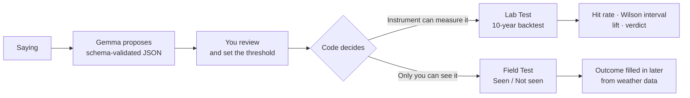

<div align="center">

# 🌿 Lore Lab

### Your family's weather sayings, tested against ten years of real data.
**Then go outside, look at the sky, and put your phone away.**


[🎬 Demo video](https://www.youtube.com/watch?v=9pPZJqvJlps) · [🌐 Live demo](https://lore-lab.onrender.com/) · [📝 DEV write-up](PASTE-DEV-POST-LINK-HERE)


</div>

---

## The idea

> *"When the wind turns south, rain is in its mouth."*

Everyone has a saying like this. Almost nobody checks it. **Lore Lab checks it, and tells you honestly when the answer is "just chance."**

A small open-weight model (**Gemma**) turns a saying into a hypothesis you can test. **You** review it and set every number. **Plain code** scores it, and every result is shown next to **the bar to beat**: how often it rains anyway.

> ### Gemma proposes. Code decides.

## Two ways to test a saying

| 🔬 **Lab Test** | 👀 **Field Test** |
|---|---|
| The sign is something an instrument records: pressure, wind direction, humidity, high cloud. | The sign is something only you can see: a salt shaker, a swift, the look of the moon. |
| Scored against **ten years of past weather**. | **You are the instrument.** Tap **Seen** or **Not seen**. |
| Result in seconds. | The outcome is filled in later from weather data. |

The Field Test ends with one line: **"Logged. We'll check the sky for you. Put your phone away."** The screen is meant to be the shortest part of the experience.

Verdicts are **Promising**, **Same as chance**, **Backfires** and **On the trail** (not enough data yet). "Same as chance" is a real result.

## What makes it honest

| Guardrail | How it works |
|---|---|
| **The model never picks the number** | The hypothesis schema has no threshold field, and the server refuses to run a Lab Test until you set one. |
| **Code decides what can be tested** | The sign must be atmospheric, the proxy variable must be on a whitelist, and a "rough" match needs your explicit OK. |
| **Verdicts are arithmetic** | *Promising* only if the whole 95% Wilson interval is above the base rate; *Backfires* only if below; otherwise *Same as chance*. |
| **No bending the question** | The lab scores rain only. A saying that predicts something else (wind, for example) is not run, and the outcome is never edited to force a result. |
| **Minimum samples** | A Lab verdict needs at least 30 sign-present days; a Field verdict needs 10 looks. Below that the card says *On the trail* and shows no hit rate. |
| **Rules before results** | The constants below were committed before any result was viewed. |

## Rules written before results

| Constant | Value | Where |
|---|---|---|
| What counts as rain | 0.2 mm or more | `backtest.py` |
| Backtest "look" time | 18:00 local | `backtest.py` |
| Lab outcome window | 24 hours, starting at the next full hour | `backtest.py` |
| Field outcome window | set per hypothesis; 12 hours for the salt-shaker look reported below | `server.py` |
| Minimum sign-present days (Lab) | 30 | `backtest.py` |
| Minimum sign-present looks (Field) | 10 | Field Test |
| Interval | Wilson, 95% | `backtest.py` |
| History | 10 years, from Open-Meteo | `weather.py` |

## How it works



**Lazy outcome resolution.** A Field look stores when its window closes. Every time the app opens, an idempotent function fills in any due outcome from Open-Meteo hourly precipitation. Free hosts sleep, so a timer could silently never fire. A failed fetch retries up to five times, then the look is marked failed and counted separately.

## First results

### Lab Test: Delhi, 24 h window, 0.2 mm or more of rain

| Saying | Sign-present days | Hit rate (95% CI) | Bar to beat | Lift | Verdict |
|---|---|---|---|---|---|
| *When the wind turns south, rain is in its mouth* | 303 | 42% (37 to 48%), 128 hits | 19% | ×2.19 | Promising |
| *Mackerel sky, mackerel sky, never long wet, never long dry* | 794 | 47% (43 to 50%), 371 hits | 19% | ×2.42 | Promising |

Both use a **rough** proxy that I accepted: wind within 45° of south stands in for "turns south", and high cloud cover above my chosen threshold stands in for a mackerel sky. Each was run once, with no other thresholds tried.

> **"Promising" is a hint, not proof.** Both effects could simply be the monsoon: south winds and high cloud are both more common when it rains more anyway. No season-adjusted check has been built, so that is a possibility, not a finding.

### Field Test: salt shaker, Delhi, 12 h window

One look logged at about 04:34 IST on 11 October. The salt had not caked, so it was logged **Not seen**. Rain followed (0.2 mm), but the sign was absent, so the look does not count toward a verdict. The card reads **On the trail: 0 of 10 looks, 1 not seen**, and shows no hit rate below 10 looks.


## Model quality

Measured on a 21-case test set with `gemma3:4b` and prompt v2.1:

| Measure | Result |
|---|---|
| Valid JSON | 21 of 21 |
| Sign kind correct (atmospheric or not) | 17 of 18 |
| Backtestable correct | 19 of 20 |

**Known miss:** *"Red sky at night, sailor's delight"* was labelled an atmospheric sign and so came back as backtestable. The code trusts the model's label. That is why every hypothesis goes through human review.

**Refusal example:** *"When the glass falls low, prepare for a blow"* was read as predicting wind, so the Lab did not run it.


## Run it locally

Requires Python 3.10+ and [Ollama](https://ollama.com).

```bash
git clone https://github.com/Sam02i/Lore-Lab.git
cd Lore-Lab
pip install -r requirements.txt
ollama pull gemma3:4b
uvicorn server:app --reload
```

Open <http://localhost:8000>. The frontend is served by the same FastAPI app. Weather history comes from [Open-Meteo](https://open-meteo.com), so the first Lab Test needs a network connection. Gemma itself runs entirely on your machine: no cloud model, no account, no tracking.

## Project layout

| File | Role |
|---|---|
| `extract.py`, `prompt.py` | Ask Gemma (via Ollama) for a JSON hypothesis |
| `schema.py` | Validates the hypothesis; decides what is backtestable |
| `adapter.py` | Shapes the hypothesis for the frontend |
| `weather.py` | Geocoding and hourly history from Open-Meteo |
| `backtest.py` | Sign masks, Wilson interval, the pre-committed constants |
| `lab.py`, `scorecard.py` | Build the scorecard returned to the UI |
| `server.py` | FastAPI routes; serves `frontend/` |
| `run_test.py` | Runs the extraction test set |
| `frontend/` | The web app |
| `docs/` | Screenshots used in this README |

## Hosted demo

The live demo runs on Render's free plan. Render does not run Gemma, so the hosted app serves hypotheses that Gemma generated locally and saved in `pregenerated.json`. There is no persistent logbook on the free plan, and the Delhi weather history ships as a cache file because the free host's shared IP hit Open-Meteo's daily request limit. It is the same history the local run downloaded. Real Field Test looks live on the local app.

> Free hosting sleeps. The first load can take about a minute.

## Limits

- Reanalysis (modelled) data, not weather-station readings.
- One place, ten years: a hint, not proof.
- The proxies only approximate the sayings.
- Lore Lab does not prove a saying true and does not forecast better than meteorologists.
- Field samples from a few days of building are tiny, and the app says so.
- **Not built:** a season-adjusted check, a second Gemma size comparison, a Dolbear's-law test, photos, offline mode, a daily look card.
- The artwork in the app was collected from Pinterest. The original artists are unknown and no rights are claimed.

## License

MIT. See [LICENSE](LICENSE).

---

<div align="center">

Built by **Samiksha Tripathy** for the Hacktoberfest Open-Source AI Challenge, Week 1: *Touch Grass*.

**Close the tab. Look at the sky. Put your phone away.** 🌿

</div>