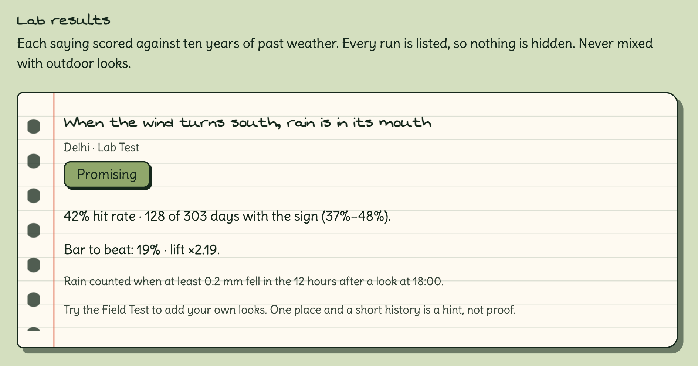
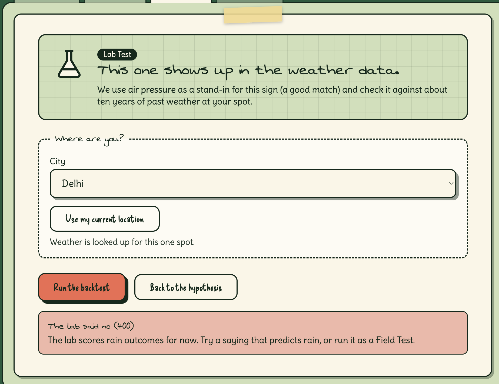
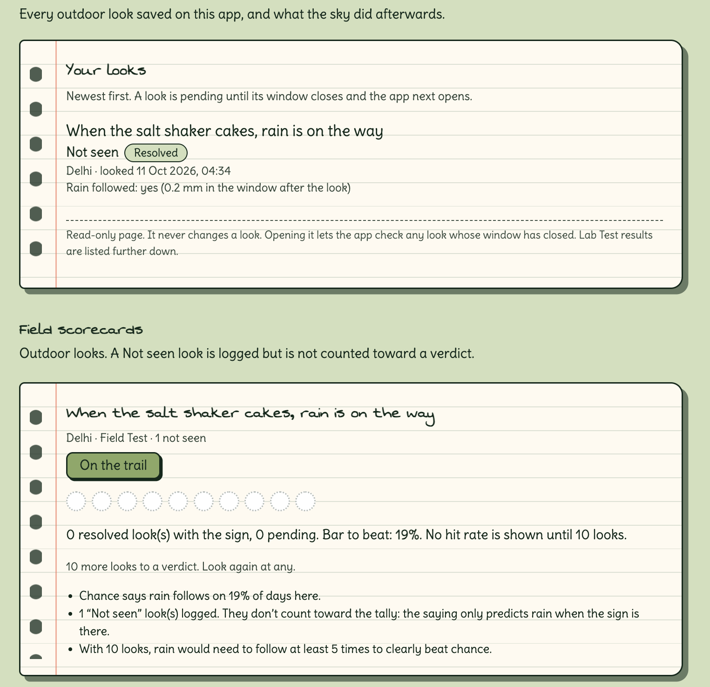
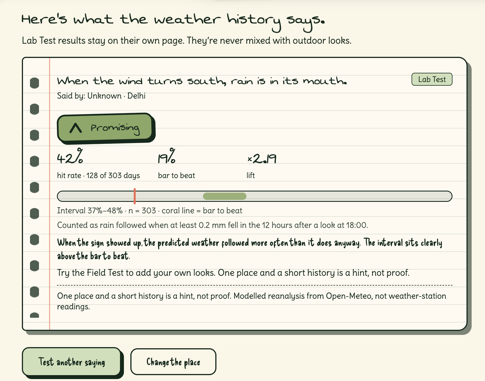

# Lore Lab

**Your grandmother said it. Lore Lab goes outside with you to find out if she was right.**

Lore Lab turns folk weather sayings into small, honest experiments. A local open-weight model
(Gemma, through Ollama) reads a saying in any language and turns it into something you can check.
You review it and set every number yourself. Then either:

* **Lab Test**: the sign is something an instrument records (pressure, wind direction, humidity, high cloud),
  so the saying is scored against ten years of past weather, or
* **Field Test**: the sign is a swift, a cow, a pine cone, the look of the moon. No instrument records those,
  so *you* are the instrument: step outside, tap **Seen** or **Not seen**, and put the phone away.
  Lore Lab checks the sky for you later.

Every result is shown next to the **bar to beat**: how often it rains anyway. A saying only means something
if it beats that. "Same as chance" is a real result and is shown with the same pride as "Promising".

Built for the Hacktoberfest Open-Source AI Challenge, Week 1 "Touch Grass".

**Live demo:** [[RENDER_URL]] (pre-generated sayings only, free Render plan; see "Hosted demo" below)
**Demo video:** [[VIDEO_URL]]
**Post:** [[DEV_POST_URL]]

## Partner technologies

| Category | Real use in this project |
|---|---|
| **Gemma** | `gemma3:4b`, run locally through Ollama, reads a saying in any language and returns a schema-validated hypothesis (translation, sign, how to observe it, predicted outcome, proxy variable, ambiguities). Measured on a 21-case test set (below). |
| **Render** | Hosts the web app and API as a free web service. There is no persistent disk, so data saved on the hosted app is lost when it restarts. Gemma is not hosted there (see "Hosted demo"). |

## Screenshots

**A verdict (Lab Test).** "When the wind turns south, rain is in its mouth", Delhi, 303 evenings with a south wind.



**The app declining to score a saying it can't test.** Gemma read "When the glass falls low, prepare for a blow" as predicting *wind*.
The Lab only scores rain, so it would not run it. It was not edited to say rain to force a result.



**An honest in-progress result (Field Test).** Salt shaker, Delhi: one look logged on 11 Oct at about 04:34 IST, tapped **Not seen**. Its outcome window closes at 17:30 IST on 11 Oct. A Not seen look does not count toward a verdict, so the card reads "On the trail, 0 of 10 looks, 1 not seen".



**Hosted demo.** South-wind Lab Test run on the hosted free Render app, using pre-generated sayings. The numbers match my local run.



## How it works

```
Saying -> Gemma proposes a hypothesis (JSON, schema-validated, closed vocabularies)
       -> you review, edit and set the threshold (the model never picks a number)
       -> plain code decides Lab Test or Field Test      <- "Gemma proposes, code decides"
       -> Lab:   10-year backtest, Wilson interval, lift, verdict
          Field: look outside -> Seen / Not seen -> outcome filled in lazily from weather data
```

* **Gemma proposes, code decides.** `schema.is_backtestable()` is the only thing that classifies a saying as a
  Lab Test: `sign.kind == "atmospheric"` AND proxy variable on the whitelist AND `fit != "none"`.
  A "rough" fit needs your explicit OK.
* **No threshold from the model.** The schema has no threshold field at all. You set the number.
* **Lazy, idempotent outcome resolution** (`resolve.py`). No scheduler or workflow engine. Every time the app is
  opened, due looks are filled in from Open-Meteo hourly precipitation. Failed fetches retry, max 5 attempts, then
  the look is marked failed, excluded from scoring and counted separately.

## Run it locally (full app, live Gemma)

```bash
pip install -r requirements.txt
ollama pull gemma3:4b            # optional: LORE_MODEL=gemma3:12b python -m uvicorn server:app
uvicorn server:app
# open http://127.0.0.1:8000
```

Tests (offline, no model, no network): `pip install -r requirements-dev.txt && python -m pytest -q`

Model comparison for the write-up: `python run_test.py gemma3:4b gemma3:12b` (saves `results/<model>.json`).

## Hosted demo (Render)

Render does not run Gemma. So the hosted app works like this:

* `pregenerate.py` ran Gemma locally once over the verified starter sayings and saved the validated output to
  `pregenerated.json`. The hosted app serves those hypotheses and labels them "(pre-generated)".
* Typing a brand-new saying works only in the local app. The hosted page says so instead of failing.
* Saved data lives on the free instance's temporary disk and is lost on restart.
* The hosted app ships the Delhi weather history my local run downloaded (cache files in `cache/`), because the free host shared an IP that hit Open-Meteo's daily request limit. The data and the result match my local run.
* The hosted notebook is shared and has no accounts. **My real looks were logged on my local app.** Anything logged
  on the hosted link is demo data and is not counted in the results below.

To reproduce the Delhi result on the hosted link: pick "When the wind turns south, rain is in its mouth", accept the
rough match, choose the **South** chip (180°), set the place to Delhi, run the Lab Test.

## Pre-committed constants

Set in `config.py` and committed **before** looking at any new result. `GET /api/config` returns them.

| Constant | Value | Meaning |
|---|---|---|
| `MIN_N_BACKTEST` | 30 | sign-present days before a Lab Test shows a hit rate or verdict |
| `MIN_N_LIVE` | 10 | sign-present looks, on different days, before a Field Test shows a verdict |
| `RAIN_MM` | 0.2 | total precipitation in the window that counts as "rain" |
| `WINDOW_H` | 12 | outcome window in hours; starts at the next full hour after the look |
| `LOOK_HOUR` | 18 | local hour a backtest "looks outside" (dusk) |
| `HISTORY_YEARS` | 10 | years of reanalysis used by the Lab Test |

Deviation from the original plan, stated openly: the PRD drafted a 24 h window. It was shortened to 12 h so a
real evening look can resolve inside the build window. An earlier exploratory Lab run (Delhi, falling pressure,
24 h window) predates these constants and is **not** in the results below.
Results below were produced with the constants above.

## How looks are counted

* Only **Seen** looks are sign-present looks. **Not seen** looks are logged and shown separately.
* **One look per local day counts.** Extra looks the same evening are noted and not counted.
* Pending looks appear on the tally but are never scored. Failed looks are excluded and counted separately.
* Lab and Field results are **never pooled**.
* Below the minimum N the card shows raw counts, the bar to beat, and what result would count
  (computed from the Wilson interval for the current N and base rate, never hardcoded). No hit rate,
  interval or verdict appears until the minimum is reached.

## Results

All numbers are copied from the app's own cards. Nothing is rounded up.

| Saying | Place | Mode | N | Bar to beat | Hit rate (95% CI) | Verdict |
|---|---|---|---|---|---|---|
| When the wind turns south, rain is in its mouth | Delhi | Lab | 303 days | 19% | 42% (37-48%), 128 of 303; lift x2.19 | Promising |
| Mackerel sky, mackerel sky, never long wet, never long dry | Delhi | Lab | 794 days | 19% | 47% (43-50%), 371 of 794; lift x2.42 | Promising |
| When the glass falls low, prepare for a blow | Delhi | Lab | not scored | not scored | not scored | Model read the outcome as "wind"; the Lab scores rain only |
| Salt shaker (Field look) | Delhi | Field | 0 of 10 looks, 1 not seen | not shown below N = 10 | not shown below N = 10 | On the trail |

How the Delhi Lab rows were run: for the south-wind saying, sign = wind from within 45 degrees of south
(threshold 180 degrees). For the mackerel saying, sign = high cloud cover at or above
[[the cloud-cover threshold you typed]]. In both cases Gemma rated the proxy a "rough" fit and I accepted it,
outcome = at least 0.2 mm of rain in the 12 hours after a look at 18:00. Each was run once with that number and
I did not try other thresholds. The earlier exploratory 24 h falling-pressure run is not in this table.

What "Promising" does and does not say: the interval sits above the bar to beat, for one place and a short
history. It does not show the saying works. A **possible** explanation, untested here, is the season: south and
south-easterly winds are more common in Delhi's monsoon, when it rains more anyway. The season-adjusted check
(TabPFN) is not built.

### Gemma extraction test (`run_test.py`, `gemma3:4b`, prompt v2.1)

| Measure | Result |
|---|---|
| Valid JSON | 21 of 21 |
| Sign kind correct (atmospheric vs not) | 17 of 18 scored |
| Backtestable correct | 19 of 20 scored |

The scored miss: "Red sky at night, sailor's delight" was labelled *atmospheric* (expected *celestial*), so it came
back as backtestable. Code decides backtestability *from the model's label*, so a wrong label can pass through.
That is why you review every hypothesis, and why accuracy is measured and reported. Full rows: `results/gemma3_4b.json`.
One saying ("Dew on the grass...") is ambiguous on purpose and is reported but not scored.

## Limits (please read)

* **Reanalysis, not stations.** The ten-year history is ERA5 reanalysis served by Open-Meteo: modelled data.
* **One place, a short history is a hint, not proof.** Lore Lab does not prove a saying true and does not
  forecast better than meteorologists.
* **Small pilot.** Field samples from a short build window are tiny. The UI says so.
* **Rain only.** The Lab Test scores rain outcomes; other predicted events run as Field Tests.
* **Small-model errors.** Gemma sometimes misclassifies a sign (see above).
* **Shared hosted notebook.** No accounts. Real results come from the local app.
* **Storage.** Hypotheses are saved to `hypotheses.json` and Field notes to `data.json` (both gitignored,
  atomic writes). Plain files are a deliberate choice for a one-person demo, not a production design.
* **Not built:** TabPFN context-adjusted lift, Dolbear's law test, photos, offline mode, Daily Look Card,
  Temporal (removed in favour of lazy resolution), a comparison of a second Gemma size, live Gemma on the hosted link.

## Starter corpus

`proverbs.json` holds the starter sayings with provenance notes. Only entries marked `"verified": true`
are served to the app. Entries with `"verified": false` are kept in the file for transparency and are
never presented as verified. Sources are never invented; unknown means `unknown`.

## Rules and credits

* Project started inside the challenge window; repo created fresh.
* Open-Meteo (geocoding, archive, forecast), Ollama + Gemma, FastAPI, pandas, Render.
* Artwork in `frontend/assets`: [[who made it, or its licence; delete this line if it is all your own]]
* Code is released under the MIT license (`LICENSE`).
* Any commit after the deadline is listed here: _none yet_.